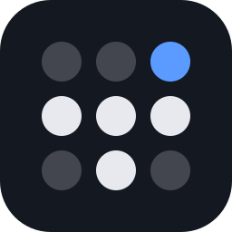
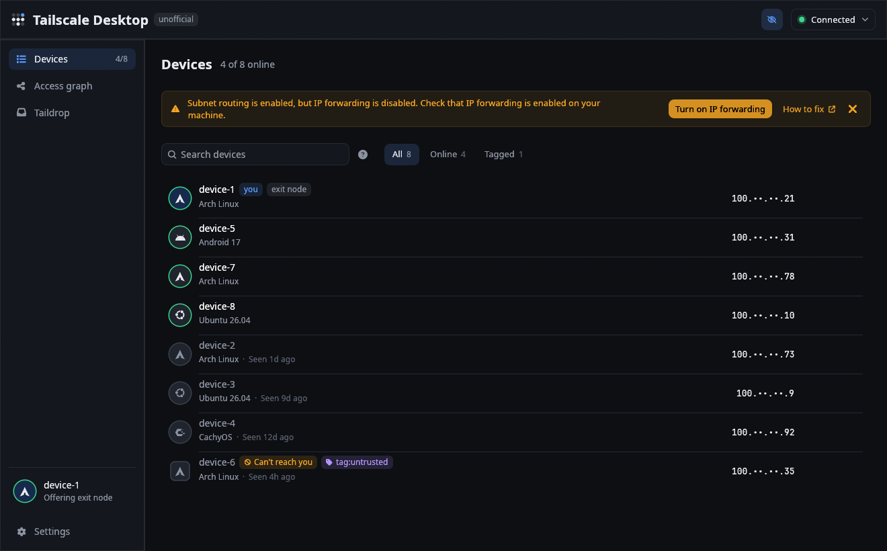
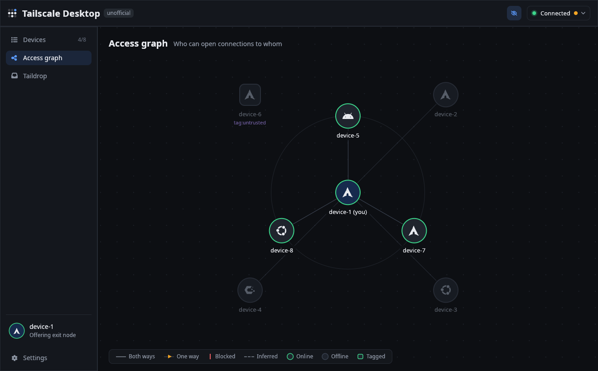
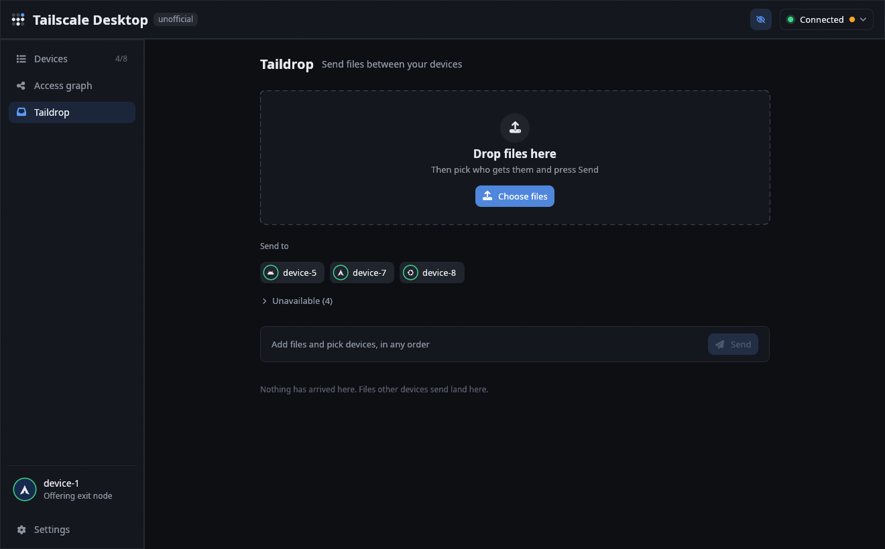
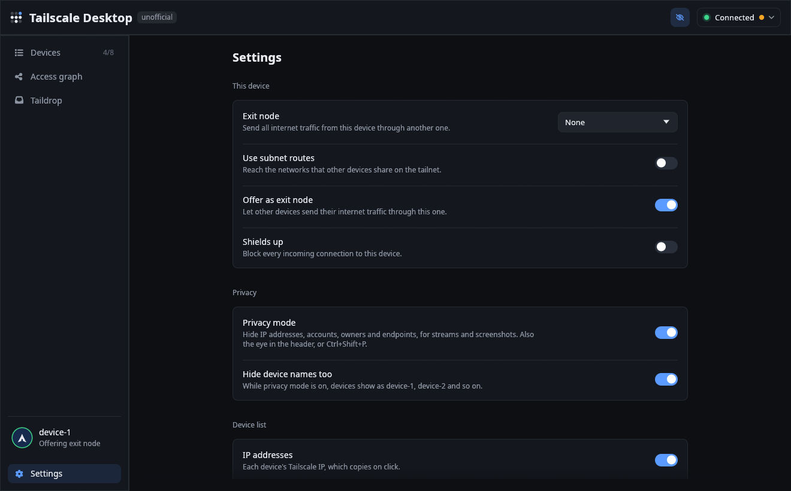
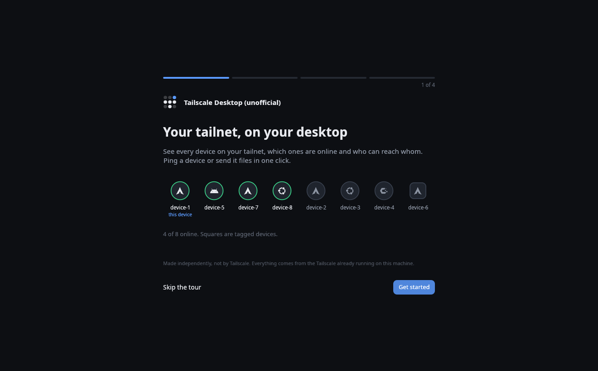

# Tailscale Desktop (unofficial)

A small native Linux window for Tailscale, written in Rust with egui. It talks to the local
`tailscaled` over its socket, so it needs no API key and no web UI. You see every device on your
tailnet, who can reach whom, and you can send files with Taildrop, all without opening a browser.

> **Unofficial.** This app is made independently and is not affiliated with, endorsed by or made
> by Tailscale Inc. Tailscale and the Tailscale logo are trademarks of Tailscale Inc. The logo is
> used so people can see at once what the app is for. Its top right dot is lit blue to mark it as
> the unofficial one. If anyone at Tailscale wants this code, it is theirs to take.

## What it does

- every device on the tailnet, online or when it was last seen, owner or tags, OS, and a note only
  when something is off: a relayed path, or access blocked one way or both
- every device's own OS logo: the distro (Arch, Ubuntu, Debian, Fedora, openSUSE, NixOS, Mint,
  CachyOS and about 45 more), the mark of its Windows 11, 10 or 7, Apple's mark, and for phones,
  tablets and TVs the kind of device its name suggests. Hover a badge to read what it is
- search by name or IP, or narrow it with `tag:`, `os:`, `user:` and `is:offline`; the `?` beside the
  search box lists them
- click any IP or MagicDNS name to copy it
- privacy mode, from the eye in the header or Ctrl+Shift+P: IPs show as `100.••.••.21`, accounts,
  owners and endpoints are hidden, and device names can become device-1, device-2. Copying still
  copies the real address. It stays on until you turn it off. Every screenshot here has it on
- ping a device five times and see latency and the path
- an access graph of who can open connections to whom, with one-way links drawn as arrows
- Taildrop: pick devices and files in any order and press Send, or drop files straight onto one
  device's chip; files waiting for this device show in a small inbox
- in Settings: exit node picker, LAN access, subnet routes, offering this device as an exit node,
  shields up, which columns the device list shows, and version info
- an on/off switch for Tailscale itself in the status menu
- health warnings from tailscaled, with a one-click fix where there is one (IP forwarding). Close
  the banner and the warning stays as an amber dot on the status pill, with the fix in its menu

On first launch a short walkthrough explains the app and offers to set up OS versions. Welcome
tour in Settings, or in the menu behind the status pill, opens it again.

| Access graph | Taildrop |
| --- | --- |
|  |  |
| **Settings** | **First launch** |
|  |  |

## Install

You need Linux with `tailscaled` running, and a Rust toolchain. On Debian or Ubuntu the build
also wants `libxkbcommon-dev libwayland-dev libgtk-3-dev`.

    git clone https://github.com/marcusbandit/tailscale-desktop-unofficial
    cd tailscale-desktop-unofficial
    scripts/install.sh

`install.sh` builds a release binary and installs it for your user, with a desktop entry and
icon. To try it without installing, run `cargo run --release`.

Make your user the Tailscale operator so changes work without root:

    sudo tailscale set --operator=$USER

If it is not, the on/off switch falls back to asking for root through polkit or a terminal
running sudo.

## OS versions

tailscaled knows this device's distro and kernel, but peers only report their OS family. For the
rest the app asks the Tailscale API. The first-run walkthrough sets this up, and Set up under
Device details in Settings opens the same steps: create an OAuth trust credential with the
All - Read scope, and paste its secret. The app keeps it in the desktop keyring through
`secret-tool`, and the credential can't change anything on the tailnet. The API gives the distro,
the kernel on Linux, and the OS version on Android, Windows, macOS and iOS. Results are cached in
`~/.cache/tailscale-desktop-unofficial/os.json` and refresh every 15 minutes.

This step is optional. Without it each device shows its OS family logo.

## How the access graph knows

A device only receives the packet filter for its own inbound traffic, so the graph combines:

- exact: this device's packet filter, which says who may reach it and on which ports
- probed: an ICMP ping through the tunnel to each online peer, which only comes back when the
  peer's filter lets this device in
- inferred: policies are written against users and tags, so devices with the same owner and tags
  are drawn the way a known device of that kind behaves. Inferred links are dashed.

## Support the app

The app is free and stays free, with nothing locked behind a payment. I build it in my spare
time. If it saves you a trip to the admin console, you can buy me a coffee on
[Ko-fi](https://ko-fi.com/marcusbandit).

The money goes to me, the person who writes this app. None of it goes to Tailscale Inc., and
giving does not make this an official Tailscale product. If you want to support Tailscale itself,
pay for a Tailscale plan.

Bug reports and ideas are just as welcome, in [Issues](https://github.com/marcusbandit/tailscale-desktop-unofficial/issues).

## Test hooks

`TSDU_SHOT=out.png` renders for `TSDU_DELAY` seconds (default 6), writes a PNG of the window and
quits. `TSDU_VIEW=graph|taildrop|settings` picks the view, `TSDU_MENU=1` opens the status menu,
`TSDU_PRIVACY=1` and `TSDU_PRIVACY_NAMES=1` turn privacy mode on, `TSDU_SHOW_IPS=0` and
`TSDU_SHOW_KERNEL=1` set the list columns, `TSDU_SCROLL=<px>` holds Settings scrolled down,
`TSDU_SELECT=<device>` opens a device, and `TSDU_PING=1` pings it first. `TSDU_ONBOARD=0..3` opens
the first-run walkthrough at that page. `TSDU_PAN_AT=<seconds>` throws the graph camera off screen
at that moment to test that it returns. `scripts/shot.sh NAME [VAR=value ...]` runs all of this
inside a headless gamescope and saves the PNG to `captures/`.

## Icons

The OS logos in `assets/os-icons.ttf` are a subset of Symbols Nerd Font 3.5.1 from
[Nerd Fonts](https://github.com/ryanoasis/nerd-fonts), MIT licensed, plus six phone and TV maker
logos converted from [Simple Icons](https://simpleicons.org) (CC0); see
`assets/os-icons-LICENSE.txt`. `scripts/build-os-icons.py` rebuilds the font. The logos are
trademarks of their owners and are shown only to say what each device runs.

## License

MIT, see [LICENSE](LICENSE). The Tailscale name and logo are not covered by it; they belong to
Tailscale Inc.
